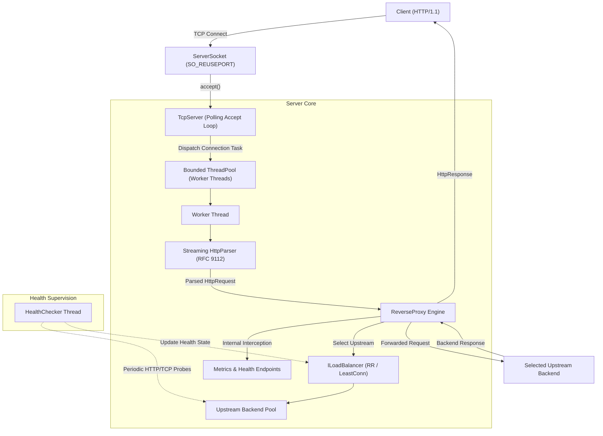

# High-Performance C++ HTTP Reverse Proxy & Load Balancer

[](https://github.com/RoshanGowdaR/WEB-SERVER-LOAD-BALANCER/actions)
[](https://en.cppreference.com/w/cpp/20)
[](https://ubuntu.com/)
[](https://github.com/google/sanitizers)
[](LICENSE)

An enterprise-grade, high-performance, multithreaded HTTP/1.1 reverse proxy and load balancer engineered from scratch in **modern C++20** using direct **Linux POSIX networking APIs**. 

Designed for high-throughput, low-latency microservice architectures, this system distributes client traffic across upstream backends, provides active health monitoring with hysteresis recovery, protects against memory exhaustion via bounded-queue backpressure, and natively exposes Prometheus-compatible metrics.

---

## 1. Problem Statement & Motivation

Modern backend infrastructure requires reverse proxies that can distribute high-volume client traffic across dynamic clusters of backend application servers. While production proxies like Nginx or Envoy exist, standard software engineering candidates and students frequently lack visibility into the low-level operating system, socket programming, and concurrent data structure fundamentals that power them.

This project exists to demonstrate:
- **Low-Level Systems Programming:** Direct POSIX socket management (`socket`, `bind`, `listen`, `accept`, `setsockopt`, `poll`) without third-party networking frameworks.
- **Modern C++20 Architecture:** RAII resource management, move semantics, atomic memory models, and zero-overhead abstractions.
- **Concurrency & Backpressure:** Fixed-thread pools with bounded task queues to eliminate thread-exhaustion and Out-Of-Memory (OOM) crashes under load.
- **Protocol Security:** Protection against HTTP request smuggling, Slowloris attacks, and memory buffer overflows.
- **Observability:** Built-in Prometheus telemetry and health status endpoints.

---

## 2. Key Features

- **Core POSIX Networking:** Non-blocking connection handling with timeout controls, `SO_REUSEADDR`, `SO_REUSEPORT`, `TCP_NODELAY`, and `SIGPIPE` process immunity (`MSG_NOSIGNAL`).
- **RFC 9112 Streaming HTTP Parser:** State-machine parser handling incremental TCP byte streams for `GET`, `POST`, `PUT`, `DELETE`, `HEAD`, and `OPTIONS`.
- **Bounded Concurrency Engine:** Thread pool with configurable worker threads, bounded task queues, and backpressure rejection (`503 Service Unavailable` with `Retry-After: 5`).
- **Load Balancing Algorithms:**
  - **Round Robin:** Atomic cyclic distribution across healthy backends.
  - **Least Connections:** Dynamic least-loaded instance selection with uniform tie-breaking.
- **Active Health Monitoring:** Background probing service evaluating backend availability with failure and recovery hysteresis thresholds to prevent flapping.
- **Reverse Proxy Core:** Header forwarding (`X-Forwarded-For`, `X-Forwarded-Proto`, `Via`), client keep-alive support, and synthetic error generation (`502 Bad Gateway`, `504 Gateway Timeout`).
- **Native Observability:**
  - `GET /health`: JSON health status and healthy backend count.
  - `GET /metrics`: Prometheus-compatible exposition format.
  - `GET /backends`: JSON array of backend nodes and connection statistics.
- **Security & Reliability:** Hard boundaries on header sizes (8 KB) and request bodies (10 MB), loopback binding by default, and verified zero memory leaks under AddressSanitizer.

---

## 3. Architecture & Data Flow



For comprehensive architectural design, see:
- [System Architecture](docs/architecture/SYSTEM_ARCHITECTURE.md)
- [Component Design](docs/architecture/COMPONENT_DESIGN.md)
- [Data Flow & Lifecycle](docs/architecture/DATA_FLOW.md)
- [Threading & Concurrency Model](docs/architecture/THREADING_MODEL.md)
- [Class Diagram](docs/architecture/CLASS_DIAGRAM.md)

---

## 4. Technology Stack

- **Core Standard:** C++20 (`-std=c++20`)
- **Operating System:** Linux / Ubuntu (POSIX.1-2008 compliant, verified on WSL2)
- **Compiler:** GCC 13.3+ or Clang 16+
- **Build System:** CMake 3.20+
- **Testing Framework:** GoogleTest v1.14.0 & CTest
- **Sanitizers:** AddressSanitizer (ASan) & UndefinedBehaviorSanitizer (UBSan)
- **Benchmarking:** ApacheBench (`ab`) v2.3
- **DevOps:** Docker (Multi-stage build), Docker Compose, GitHub Actions CI

---

## 5. Repository Structure

```text
├── src/
│   ├── main.cpp                     # Application entry point & signal handling
│   ├── server/                      # TCP server & connection dispatching
│   ├── network/                     # POSIX socket RAII wrappers
│   ├── http/                        # HTTP parser, request/response models
│   ├── threading/                   # Bounded ThreadPool with backpressure
│   ├── proxy/                       # Reverse proxy forwarding engine
│   ├── balancer/                    # Round Robin & Least Connections algorithms
│   ├── health/                      # Background health monitor with hysteresis
│   ├── monitoring/                  # Prometheus metrics & JSON telemetry
│   ├── config/                      # JSON configuration parser & validator
│   └── logging/                     # Thread-safe structured logger
├── include/                         # Public headers for all subsystems
├── tests/
│   ├── unit/                        # Unit tests (socket, parser, pool, balancer, etc.)
│   ├── integration/                 # Integration tests (proxy, health, concurrency)
│   ├── regression/                  # Edge cases & regression tests
│   └── fuzz/                        # 10,000-iteration HTTP mutation fuzzer
├── config/
│   └── config.example.json          # Configuration template
├── benchmarks/                      # Automated benchmark harness & results
├── docker/                          # Container assets
├── scripts/                         # End-to-end automated verification script
├── docs/                            # Comprehensive technical documentation
│   ├── architecture/                # System diagrams & design models
│   ├── design/                      # Technical design & Architecture Decision Records (ADRs)
│   ├── api/                         # API reference & protocol specifications
│   ├── testing/                     # Test strategy, test matrix & coverage report
│   ├── bugs/                        # Bug fix history & known limitations
│   ├── operations/                  # Deployment guide, runbook & troubleshooting
│   ├── security/                    # Threat model & security review
│   ├── performance/                 # Measured benchmark reports & methodology
│   └── interview/                   # 65+ Question Interview Handbook & Defense Guide
├── Dockerfile                       # Multi-stage optimized container image
├── docker-compose.yml               # Complete local cluster manifest
└── CMakeLists.txt                   # CMake build definition
```

---

## 6. Getting Started

### Prerequisites (Ubuntu / Debian / WSL2)
```bash
sudo apt update
sudo apt install -y build-essential cmake git libgtest-dev apache2-utils python3
```

### Build Instructions

#### 1. Optimized Release Build
```bash
cmake -B build -S . -DCMAKE_BUILD_TYPE=Release -DBUILD_TESTING=ON
cmake --build build -j$(nproc)
```

#### 2. AddressSanitizer & UndefinedBehaviorSanitizer Build
```bash
cmake -B build-asan -S . -DENABLE_ASAN=ON -DBUILD_TESTING=ON
cmake --build build-asan -j$(nproc)
```

---

## 7. Running the Application

Start the load balancer using the default configuration (`config/config.example.json`):
```bash
./build/load_balancer_server -c config/config.example.json -v
```

Command-Line Options:
```text
Usage: load_balancer_server [options]
Options:
  -c, --config <file>    Path to JSON configuration file (default: config/config.example.json)
  -p, --port <port>      Override listening port
  -a, --algo <algorithm> Load balancing algorithm ('round_robin' or 'least_connections')
  -v, --verbose          Enable DEBUG level logging
  -h, --help             Display this help message
```

---

## 8. Administrative Endpoints

The reverse proxy intercepts these endpoints directly in memory:

| Endpoint | Method | Response Type | Description |
| :--- | :--- | :--- | :--- |
| `/health` | `GET` | `application/json` | Overall status (`UP` / `DEGRADED`) and healthy backend counts. |
| `/metrics` | `GET` | `text/plain` | Prometheus-compatible metrics (requests, latency, gauges). |
| `/backends` | `GET` | `application/json` | Array of backends with active connections and total requests. |

---

## 9. Testing & Quality Assurance

The test suite covers unit tests, integration tests, concurrency tests, mutation fuzzing, and end-to-end validation.

```bash
# 1. Run all tests via CTest
cd build && ctest --output-on-failure

# 2. Run unit tests directly
./build/tests/unit_tests

# 3. Run integration tests directly
./build/tests/integration_tests

# 4. Run mutation fuzz test (10,000 iterations)
./build/tests/fuzz_http_parser

# 5. Run automated End-to-End multi-process validation
python3 scripts/e2e_test.py
```

### Test Results Summary
- **Unit & Integration Tests:** 34 / 34 PASSED (100%)
- **Fuzz Iterations:** 10,000 / 10,000 PASSED (0 crashes)
- **E2E System Validation:** PASSED
- **Sanitizers (ASan + UBSan):** CLEAN (0 leaks, 0 errors)

Detailed test documentation:
- [Test Strategy](docs/testing/TEST_STRATEGY.md)
- [Test Cases Matrix](docs/testing/TEST_CASES.md)
- [Execution Report](docs/testing/TEST_EXECUTION_REPORT.md)
- [Coverage Report](docs/testing/TEST_COVERAGE_REPORT.md)

---

## 10. Performance Benchmarks

Measured using ApacheBench (`ab`) on WSL2 Ubuntu 24.04 (Linux 5.15 x86_64, GCC 13.3 `-O3`, 8 worker threads, 3 backends):

| Concurrency | Total Requests | Throughput | Mean Latency | P95 Latency | P99 Latency | Failed Requests |
| :--- | :--- | :--- | :--- | :--- | :--- | :--- |
| **`c = 10`** | 5,000 | **2,130 req/sec** | **4.69 ms** | **8 ms** | **10 ms** | **0** |
| **`c = 50`** | 5,000 | **1,545 req/sec** | **32.35 ms** | **29 ms** | **31 ms** | **0** |
| **`c = 100`** | 5,000 | **1,870 req/sec** | **53.45 ms** | **64 ms** | **72 ms** | **0** |

Run the automated benchmark suite:
```bash
./benchmarks/run_benchmark.sh
```
See [Performance Report](docs/performance/PERFORMANCE_REPORT.md) for full metrics and methodology.

---

## 11. Docker Deployment

Deploy a complete multi-container cluster (Load Balancer + 3 Microservices):
```bash
docker compose up -d --build
```
Inspect cluster health:
```bash
curl http://localhost:8080/health
curl http://localhost:8080/metrics
```
Stop the cluster:
```bash
docker compose down
```

---

## 12. Interview Preparation Handbook

This project includes a dedicated interview preparation handbook designed for senior technical interviews:
- [Project Pitch & Walkthrough (30s, 1m, 3m)](docs/interview/PROJECT_EXPLANATION.md)
- [Architecture Walkthrough](docs/interview/ARCHITECTURE_WALKTHROUGH.md)
- [C++ Core Concepts](docs/interview/CPP_CONCEPTS.md)
- [Networking & Sockets](docs/interview/NETWORKING_CONCEPTS.md)
- [Operating Systems Primitives](docs/interview/OPERATING_SYSTEMS_CONCEPTS.md)
- [Concurrency & Synchronization](docs/interview/CONCURRENCY_CONCEPTS.md)
- [Data Structures & Algorithms](docs/interview/DSA_CONNECTIONS.md)
- [Comprehensive 65+ Question Bank](docs/interview/INTERVIEW_QUESTIONS.md)
- [Technical Defense Guide](docs/interview/TECHNICAL_DEFENSE.md)

---

## 13. License

Distributed under the MIT License. See [LICENSE](LICENSE) for details.
