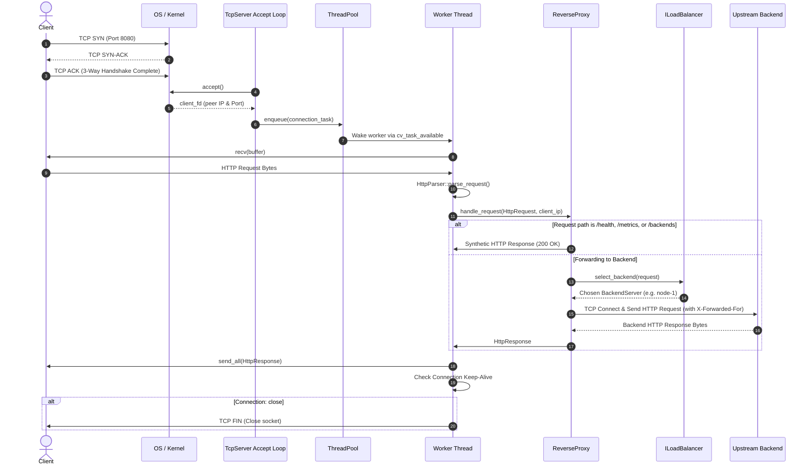

# Data Flow & Request Lifecycle

This document describes the step-by-step end-to-end lifecycle of an HTTP request traversing the load balancer.

---

## Detailed Step Walkthrough

1. **TCP Handshake:** Client establishes a standard TCP 3-way handshake with the server's listening socket.
2. **Acceptance:** `TcpServer`'s accept loop wakes up via `::poll()`, extracts the client socket, and wraps it into an RAII handle.
3. **Task Dispatch:** The connection task is submitted to `ThreadPool`. If the queue is saturated, a `503 Service Unavailable` with `Retry-After: 5` is returned immediately.
4. **Parsing:** The worker thread executes an incremental streaming read loop using `HttpParser`. Headers are parsed and validated against size limits.
5. **Routing / Interception:**
   - Administrative endpoints (`/health`, `/metrics`, `/backends`) are handled directly in-memory without contacting upstreams.
   - Normal requests query `ILoadBalancer`.
6. **Upstream Forwarding:** The proxy establishes an outbound connection to the chosen backend, appends proxy headers (`X-Forwarded-For`, `Via`, `X-Forwarded-Proto`), and streams the request.
7. **Response Relaying:** The backend response is parsed, verified, and sent back to the client.
8. **Telemetry Recording:** Latency duration and status are recorded in thread-safe atomic counters in `monitoring::Metrics`.
