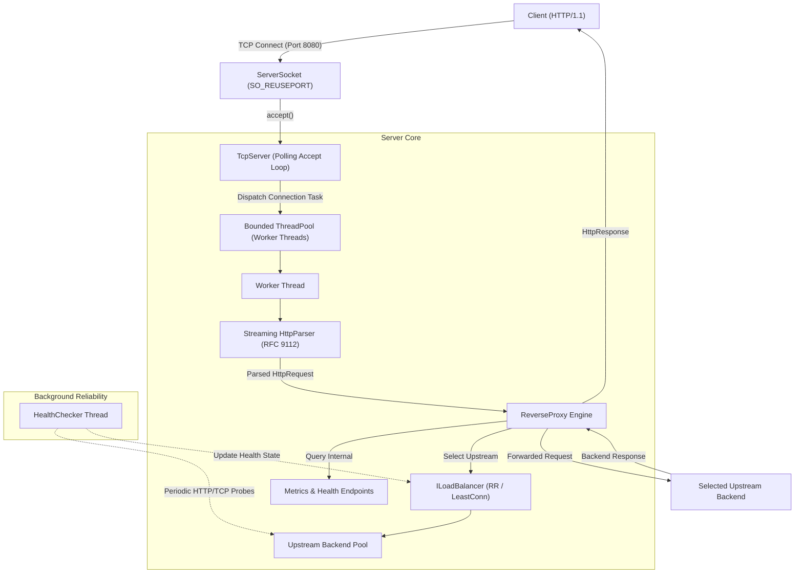

# System Architecture

## 1. High-Level Architectural Overview

The **High-Performance C++ HTTP Reverse Proxy & Load Balancer** is structured as a modular, multi-threaded systems application designed to distribute high-volume HTTP traffic across a pool of upstream backend servers with minimal overhead, bounded resource consumption, and automated fault recovery.

---

## 2. Core Subsystems

1. **Network Engine (`net::Socket`, `net::ServerSocket`, `net::ClientSocket`)**:
   - Manages raw Linux POSIX file descriptors with zero resource leakage via strict RAII semantics.
   - Non-blocking connection timeouts using `::poll()` and socket timeout options (`SO_RCVTIMEO`, `SO_SNDTIMEO`).
   - Signal protection against `SIGPIPE` using `MSG_NOSIGNAL` and process-level signal masking.

2. **HTTP/1.1 Protocol Engine (`http::HttpParser`, `http::HttpRequest`, `http::HttpResponse`)**:
   - Streaming incremental parser capable of handling segmented TCP chunks across network boundaries.
   - Enforces strict limits on header sizes (default 8 KB) and payload sizes (default 10 MB).
   - Rejects conflicting or ambiguous `Content-Length` headers to protect against HTTP request smuggling.

3. **Concurrency Engine (`threading::ThreadPool`)**:
   - Work-distribution queue backed by a configurable pool of worker threads.
   - Bounded task queue with explicit backpressure policies (`Reject`, `BlockWithTimeout`) ensuring predictable memory usage under traffic spikes.
   - Worker threads isolate task exceptions, preventing thread termination or process crashes.

4. **Load Balancing Core (`balancer::RoundRobinBalancer`, `balancer::LeastConnectionsBalancer`)**:
   - Implements thread-safe backend routing strategies.
   - Dynamically filters unhealthy or degraded backends.
   - RAII-based active connection tracking (`BackendConnectionGuard`).

5. **Active Health Monitoring (`health::HealthChecker`)**:
   - Runs on a dedicated background thread, decoupled from client request serving.
   - Active TCP/HTTP probing of `/health` with configurable intervals and timeouts.
   - Hysteresis tracking: requires $N$ consecutive failures to mark unhealthy and $M$ consecutive successes to restore healthy status.

6. **Telemetry & Metrics (`monitoring::Metrics`)**:
   - Thread-safe atomic counters tracking request volume, success rates, failures, active connections, and backpressure rejections.
   - Circular buffer recording latency distributions for P50, P95, and P99 metrics.
   - Prometheus text exposition (`/metrics`) and JSON status endpoints (`/health`, `/backends`).
